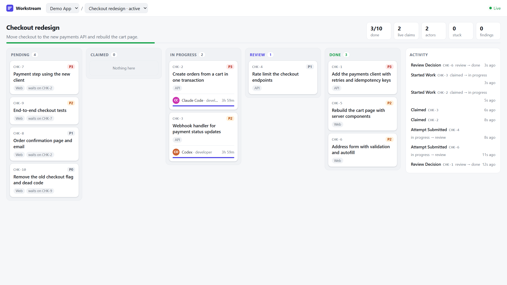

# Dashboard

A read-only web view of a plan: tasks by status, who holds each claim and how long it has left,
stuck work, and the event timeline for every task.



## Opening it

The dashboard is served by the API under your user token, next to the MCP endpoint:

```
http://localhost:8080/<your-token>/ui/
```

With the demo image that is `http://localhost:8080/demo-insecure-token/ui/`. The token is the
same one in your MCP URL, so treat the dashboard link like a password. The page sets a
`no-referrer` policy so the token is not sent to other sites.

The page polls every 4 seconds while the tab is visible. Cards that change status flash, claim
bars count down to the TTL, and stuck work (claims older than twice their TTL) is listed on the
right. Click a card for its full timeline and findings. The selected project, plan and task are
kept in the URL hash, so a link opens the same view.

## Watching agents work

`scripts/simulate-agents.mjs` creates a plan with ten tasks and runs two developer agents and a
reviewer against it through the MCP endpoint:

```bash
docker run --rm -p 127.0.0.1:8080:8080 -e WORKSTREAM_ADMIN_TOKEN=local-admin \
  ghcr.io/ahmad-codex/workstream-mcp:demo
WORKSTREAM_ADMIN_TOKEN=local-admin node scripts/simulate-agents.mjs
```

It prints the dashboard link for the new plan. `--speed 0.3` runs it faster.

## API

The page reads four endpoints, all `GET`, all under `/<token>/api`:

| Path | Returns |
|---|---|
| `/projects` | Same data as the `list_projects` tool |
| `/projects/{projectId}/plans` | Same data as `list_plans` |
| `/plans/{planId}/board` | Plan summary from `get_plan_dashboard`, plus every task with its claim holder, phase and dependencies, and the plan's findings |
| `/events/{entityType}/{entityId}` | The `get_event_log` timeline, with actor names |

Responses use the same `{ ok, data, error }` envelope as the MCP tools. Claim tokens are never
returned. These reads do not count against the per-actor MCP rate limit.

## Developing the UI

The source is in `ui/` (React, TypeScript, Vite). With a server running on port 8080:

```bash
cd ui
npm install
npm run dev        # http://localhost:5173, proxies /api to the demo token
```

Set `WORKSTREAM_URL` to point the dev server at another token, for example
`WORKSTREAM_URL=http://localhost:8080/<token> npm run dev`. `npm run build` writes to
`src/Workstream.Api/wwwroot/ui/`, which the API serves; the Docker images run this step for you.
